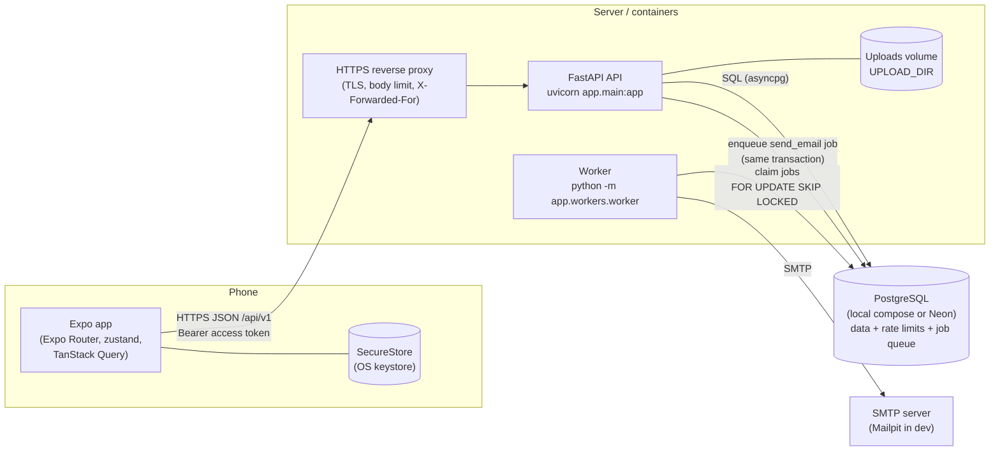

# Architecture

Status: the backend implements every phase of the product spec — auth, families, accounts /
categories / payees / transactions / attachments, UPI intent payments, budgets, recurring bills,
savings goals, notifications + Expo push, reports, dashboard. Mobile feature screens are still
being built. Remaining planned items are listed in §6.

Serverless deployment (Vercel + Neon: inline email delivery, `/internal/cron/tick` instead of
the worker, object storage): [VERCEL.md](VERCEL.md).

Related: [ER.md](ER.md) · [SECURITY.md](SECURITY.md) · [ENVIRONMENT.md](ENVIRONMENT.md) ·
[DEPLOYMENT.md](DEPLOYMENT.md)

## 1. System overview

| Component | Tech | Where |
|---|---|---|
| Mobile app | Expo SDK 58, React Native 0.88, Expo Router, TypeScript | `mobile/` |
| API | Python 3.12, FastAPI, Pydantic v2, SQLAlchemy 2.1 (async) + asyncpg | `backend/app/` |
| Worker | Same codebase and image: `python -m app.workers.worker` | `backend/app/workers/worker.py` |
| Database | PostgreSQL 17 locally (`postgres:17-alpine`), Neon for staging/prod | `docker-compose.yml`, [NEON.md](NEON.md) |
| Migrations | Alembic (async env) | `backend/alembic/` |
| Email | SMTP. Dev uses Mailpit (UI at http://localhost:8025) | `backend/app/services/email.py` |
| File storage | `FileStorage` interface: local disk under `UPLOAD_DIR` (default), a private S3-compatible bucket (`STORAGE_BACKEND=s3`, e.g. Neon object storage) or a private Vercel Blob store. Files are always served through authenticated endpoints | `backend/app/services/storage.py`, `s3_storage.py`, `blob_storage.py` |
| Push | Expo push API, called only by the worker's push sender | `backend/app/services/push.py` |

**PostgreSQL is the only stateful dependency, by design. There is no Redis.** Rate-limit
counters and the background job queue are ordinary tables (`rate_limit_counters`,
`background_jobs`).



In local development there is no proxy: the app talks to `http://<host>:8000` directly
(see `mobile/.env.example`).

### Local stack (docker compose)

```bash
cp .env.example .env
docker compose up -d --build
```

| Service | What it runs | Host port |
|---|---|---|
| `postgres` | `postgres:17-alpine`; `infra/postgres/init.sql` creates `family_budget_test` on first init | `127.0.0.1:${POSTGRES_PORT:-5432}` |
| `mailpit` | Catches all outgoing mail | SMTP `127.0.0.1:${MAILPIT_SMTP_PORT:-1025}`, UI `127.0.0.1:${MAILPIT_UI_PORT:-8025}` |
| `api` | `alembic upgrade head && uvicorn ... --reload --proxy-headers` (`dev` target, source bind-mounted) | `${API_PORT:-8000}` (all interfaces, so phones on your LAN can reach it) |
| `worker` | `python -m app.workers.worker` | none |

Volumes: `family-budget_pgdata` (database) and `family-budget_uploads` (mounted at
`/data/uploads` in `api` and `worker`).

## 2. Backend layering

```
app/
  main.py               app factory: middleware, exception handlers, /health, /health/ready, router
  api/
    deps.py             DI: DB session, settings, ClientInfo (ip, user agent), get_principal (auth)
    v1/router.py        mounts endpoint routers under API_V1_PREFIX (/api/v1)
    v1/endpoints/       one module per area (auth, users, families, accounts, categories, tags,
                        payees, transactions, attachments, upi, budgets, recurring, savings,
                        notifications, reports, dashboard): thin HTTP adapters. Every module's
                        `router` is auto-registered by v1/router.py (no shared registry edits)
  services/             business rules and transaction boundaries, one service per area, plus
                        ledger.py (the accounting rules), notify.py (create notifications),
                        push.py (Expo sender), recurrence.py (schedule math), upi_uri.py
                        (UPI URI parse/build), storage.py (files, image/PDF validation)
  repositories/         SQLAlchemy queries per area (+ audit, job queue, housekeeping)
  models/               ORM tables (user, system, family, finance, planning, upi, notification)
  schemas/              Pydantic request/response models (requests forbid unknown fields)
  core/                 config, security (hashing/JWT/codes), permissions (roles, ScopeFilter),
                        rate_limit, middleware, errors, logging, threads (bounded CPU work)
  db/                   Base + mixins + naming convention, async engine/session
  workers/worker.py     PostgreSQL-backed job runner, periodic tasks, housekeeping
  workers/jobs/         job modules (HANDLERS / PERIODIC), auto-discovered
```

Rules the code follows:

- **Endpoints** parse input (Pydantic), call one service method, and shape the response. They
  have no SQL and no business rules.
- **Services** own the unit of work. They call `await session.commit()` once the work is
  complete. The request-scoped session (`db/session.py:get_db`) rolls back anything left
  uncommitted.
- **Repositories** hold the queries. Anything that reads another user's data is scoped in the
  query itself: by `user_id` for account data (e.g. `SessionRepository.get_active_for_user`),
  and by `app.core.permissions` for personal/family data (next bullet).
- **Tenant isolation** (`core/permissions.py`): `ScopeFilter.for_user(...)` builds the WHERE
  clause for every *scoped* row (personal → `owner_user_id`; family → `family_id IN (active
  memberships of live families)` as a correlated subquery, never a client-supplied list).
  Writes go through `require_family_access(db, user, family_id, permission)` (404 when not a
  member, 403 when the role lacks the permission) or `require_record_write` for a row loaded by
  id (404 invisible, 403 viewer / member editing someone else's row). Responses carry
  `can_edit` / `can_manage` / `can_delete` flags computed with the same rules.
- **Models** use the shared conventions in `db/base.py`: UUID primary keys
  (`gen_random_uuid()`), `timestamptz` everywhere, JSONB for dicts, `NUMERIC(14,2)` money
  (`Decimal`, serialised as 2-dp strings), and a deterministic constraint naming convention.
- **Money totals** come only from `services/ledger.py` (`counted()`, `expense_amount()`,
  `income_amount()`, `totals()`, balances): completed, non-deleted rows; expense = expenses −
  refunds; transfers and adjustments are never income/expense; pending UPI payments and
  recurring bills don't count until confirmed. Budgets, reports, the dashboard, the transaction
  summary and account balances all use it, so their numbers agree.
- **Multi-step financial writes** happen in one DB transaction (UPI initiate creates the
  attempt + payee touch + pending transaction + audit together; category delete moves
  transactions, recurring rules, payee defaults and budget limits together).
- **Errors**: services raise `AppError` subclasses (`core/errors.py`). Every error response
  uses the same envelope: `{"error": {"code", "message", "details?"}}`. Validation errors
  never echo the submitted values back.

### API surface (implemented)

| Method and path | Auth | Notes |
|---|---|---|
| `GET /health` | none | Liveness |
| `GET /health/ready` | none | Runs `SELECT 1`; returns 503 if the DB is down |
| `POST /api/v1/auth/register` | none | Always 202 |
| `POST /api/v1/auth/verify-email` | none | 6-digit code. Signs the user in (returns tokens) |
| `POST /api/v1/auth/resend-verification` | none | Always 202 |
| `POST /api/v1/auth/login` | none | |
| `POST /api/v1/auth/refresh` | refresh token in body | Rotates the refresh token |
| `POST /api/v1/auth/logout`, `/logout-all` | bearer | |
| `POST /api/v1/auth/forgot-password` | none | Always 202 |
| `POST /api/v1/auth/reset-password` | none | Code + new password. Revokes all sessions |
| `GET/PATCH /api/v1/users/me` | bearer | Profile (name, IANA time zone) |
| `POST /api/v1/users/me/change-password` | bearer | Keeps this session, revokes the others |
| `PUT/GET/DELETE /api/v1/users/me/avatar` | bearer | JPEG/PNG/WebP, re-encoded to a 512px JPEG |
| `GET /api/v1/users/me/sessions`, `DELETE .../sessions/{id}` | bearer | Device list and revoke |
| `POST /api/v1/users/me/delete` | bearer + password | Soft delete and anonymise |

Feature APIs (all bearer-authenticated) are documented per area in `docs/api/`:
[families](api/families.md), [catalog](api/catalog.md) (categories, tags, payees),
[ledger](api/ledger.md) (accounts, transactions, attachments), [upi](api/upi.md),
[budgets & savings](api/budgets_savings.md), [recurring](api/recurring.md),
[notifications](api/notifications.md), [reports & dashboard](api/reports.md).

OpenAPI docs are served at `/docs` when `ENABLE_DOCS=true`. They are always off when
`ENVIRONMENT=production`.

## 3. Request lifecycle

Middleware order, outermost first (`main.py`):

1. **`RequestContextMiddleware`** (`core/middleware.py`, pure ASGI)
   - Request ID: reuses an incoming `X-Request-ID` only if it matches `^[A-Za-z0-9-]{8,64}$`.
     Otherwise it generates one. The ID is bound into structlog context and echoed as the
     `X-Request-ID` response header.
   - **Body-size cap**: if `Content-Length` exceeds 10 MiB (`MAX_REQUEST_BYTES` in `main.py`),
     it responds `413 payload_too_large` before the app runs. Chunked bodies without a
     `Content-Length` are not capped here, so also set a limit at the proxy.
   - **Security headers** on every response: `X-Content-Type-Options: nosniff`,
     `X-Frame-Options: DENY`, `Referrer-Policy: no-referrer`, `Permissions-Policy`,
     `Cross-Origin-Opener-Policy: same-origin`, and
     `Content-Security-Policy: default-src 'none'; frame-ancestors 'none'` (except on the docs
     pages). `/api/*` responses also get `Cache-Control: no-store` unless the route set its
     own. `Strict-Transport-Security` is added when `ENVIRONMENT` is `staging` or `production`.
   - One structured access-log line per request: method, path, status, duration. Uvicorn's own
     access log is disabled.
2. **`CORSMiddleware`** is added only when `CORS_ORIGINS` is non-empty. It uses an explicit
   allowlist with no credentials (bearer tokens, not cookies). Wildcard `*` is rejected in
   staging and production. Native apps don't need CORS. It exists for Expo web and other web
   clients.
3. **Route dependencies**
   - `ip_rate_limit(scope)` on the unauthenticated auth endpoints (see §4).
   - `get_db`: one `AsyncSession` per request.
   - `get_principal`: decodes the JWT, then loads the user **and** the session in one query
     (session not revoked or expired, user active and not deleted).
4. **Endpoint → service → repository → PostgreSQL.** The service commits.
5. **Exception handlers** (`core/errors.py`) map errors to the envelope. Unhandled exceptions
   are logged with their type and returned as a generic `500 internal_error`.

Client IP (`core/rate_limit.py:client_ip`) is `request.client.host`. Behind a proxy that
address is only correct if uvicorn runs with `--proxy-headers` **and** trusts the proxy via
`FORWARDED_ALLOW_IPS` (see [DEPLOYMENT.md](DEPLOYMENT.md)).

## 4. Authentication design

| Element | Implementation |
|---|---|
| Password hashing | Argon2id (`argon2-cffi`). Defaults: time cost 3, 64 MiB memory, parallelism 4 (RFC 9106 second recommended profile). Hashes are upgraded on login when parameters change (`password_needs_rehash`) |
| Password policy | 10–128 chars, a small common-password blocklist, at least 4 distinct characters, and must not contain the email's local part. No composition rules (NIST 800-63B style). Enforced server-side in `ensure_password_policy`. `mobile/src/validation/auth.ts` mirrors the length, distinct-character and email rules (not the blocklist) for early feedback |
| Access token | HS256 JWT signed with `JWT_SECRET_KEY`. Lifetime `ACCESS_TOKEN_EXPIRE_MINUTES` (default **15**). Claims: `sub` (user), `sid` (session), `typ=access`, `iss`, `iat`, `nbf`, `exp`, `jti`. The algorithm is pinned on decode |
| Session check | **Every authenticated request** checks that `sid` refers to a live `user_sessions` row for that user (not revoked, not expired, user active). Logout, revoke and password change take effect immediately, not when the JWT expires |
| Refresh token | Opaque `secrets.token_urlsafe(48)`. Only its SHA-256 is stored (`refresh_tokens.token_hash`). Each refresh **rotates** it: the old row gets `rotated_at` and a new token is issued. The session expiry slides forward by `REFRESH_TOKEN_EXPIRE_DAYS` (default 7) on each refresh |
| Reuse detection | Presenting a token that already has `rotated_at` set is treated as theft. The **whole session is revoked** (`revoked_reason = refresh_token_reuse`) and an audit row is written. Token rows are locked `FOR UPDATE`, so concurrent refreshes serialize |
| Email codes | 6-digit codes (`secrets.randbelow`) for `email_verify` and `password_reset`. Stored as `HMAC-SHA256(JWT_SECRET_KEY, "purpose:user_id:code")`, so a leaked DB can't be brute-forced offline. Expiry `EMAIL_CODE_EXPIRE_MINUTES` (30). After `EMAIL_CODE_MAX_ATTEMPTS` (5) wrong tries the code is burned. Issuing a new code invalidates the previous ones. Codes are compared in constant time |
| Anti-enumeration | `register`, `resend-verification` and `forgot-password` always return 202 with the same message. Registering an existing verified email sends an "account exists" email instead. Unknown emails on login still spend Argon2 time (`burn_password_check`). Login failures use a single generic message. "Email not verified" is only returned after a correct password |
| Brute force | Per-IP limit per auth endpoint (`AUTH_IP_RATE_LIMIT` per `AUTH_IP_RATE_WINDOW_SECONDS`). A **decaying, email-keyed** failure counter (key = keyed HMAC of the lower-cased email, never the raw address; current window + the previous one weighted by overlap): `LOGIN_MAX_FAILURES` within `LOGIN_FAILURE_WINDOW_SECONDS` locks sign-in **for that email** for `LOGIN_LOCKOUT_SECONDS` (429), whether or not the account exists, so the lock reveals nothing. It replaced the old per-account lockout (`users.locked_until`, now unused). A successful login resets the counter. A per-address email quota (`EMAIL_SEND_LIMIT` per `EMAIL_SEND_WINDOW_SECONDS`): over-quota sends are silently skipped. Wrong one-time codes are also capped per account per 24 h (`EMAIL_CODE_DAILY_MAX_FAILURES`), and re-authentication (change password / delete account) has its own limit and decaying lock (`REAUTH_*`) |
| Session revocation | Logout (this session), logout-all, revoke a device, password change (all others), password reset (all), account deletion (all) |

Rate limiting (`core/rate_limit.py`) uses fixed windows in `rate_limit_counters`, incremented
atomically with `INSERT ... ON CONFLICT (key, window_start) DO UPDATE SET count = count + 1
RETURNING count`. Route-level limiters run **in their own short transaction** (or commit the
request session immediately), so a failed request still counts even though its own
transaction rolls back. Besides the auth limits there are per-user limits on uploads, UPI
initiate/parse, CSV exports, analytics (`/reports/*`, `/dashboard`) and push-token
registration (`deps.user_rate_limit(kind)`; see [ENVIRONMENT.md](ENVIRONMENT.md)).

### Token flow

```mermaid
sequenceDiagram
    participant App
    participant API
    participant DB as PostgreSQL
    App->>API: POST /auth/login (email, password, device_name)
    API->>DB: verify Argon2id, create user_sessions + refresh_tokens(hash)
    API-->>App: access JWT (15 min, sid) + refresh token (opaque)
    App->>API: GET /users/me (Bearer)
    API->>DB: session sid live? user active?
    API-->>App: 200
    Note over App,API: access token expires
    App->>API: GET /users/me → 401
    App->>API: POST /auth/refresh (single-flight)
    API->>DB: lock token row; mark rotated_at; insert new token
    API-->>App: new access + new refresh token
    App->>API: retry GET /users/me → 200
    Note over App,API: if an already-rotated refresh token is presented again,<br/>the session is revoked and every token for it stops working
```

### Email delivery (outbox)

Services never call SMTP. `AuthService` enqueues a `send_email` row in `background_jobs`
**in the same DB transaction** as the state change (for example the new `user_tokens` row).
Commit means both exist and rollback means neither does. The worker sends it later. This
keeps response times similar whether or not the email exists, and it allows retries.

### Background worker

`python -m app.workers.worker` (`workers/worker.py`):

- Polls every `WORKER_POLL_INTERVAL_SECONDS` (2 s) and claims up to `WORKER_BATCH_SIZE` (10) due
  jobs with `SELECT ... FOR UPDATE SKIP LOCKED`, marking them `running`. Several workers can run
  safely.
- Runs each handler outside the claim transaction. Success sets status `done`. Failure sets
  status `pending` with exponential backoff (`15 s × 2^(attempts-1)`, capped at 1 h) until
  `max_attempts`, then `failed`. Unknown job kinds fail immediately.
- **Payloads are wiped** (`{}`) once a job is done or failed, because email bodies contain
  one-time codes.
- `dedupe_key` (partial unique index) lets callers enqueue idempotently. Enqueueing uses
  `ON CONFLICT DO NOTHING`.
- **Housekeeping** runs at start-up and every 30 minutes. It deletes sessions expired or revoked
  more than 30 days ago, expired refresh tokens, expired or consumed email codes, expired
  rate-limit counters, and done/failed jobs older than 7 days. It also requeues jobs stuck
  in `running` for more than 10 minutes (crashed worker).
- **Job modules are auto-discovered**: every module in `app/workers/jobs/` may export
  `HANDLERS` (job kind → coroutine) and/or `PERIODIC` (`PeriodicTask(name, every, run)`);
  `discover()` imports them all at start-up (duplicate kinds are an error) and the start-up
  log line `worker_started` lists `job_kinds` and `periodic`. Current periodic tasks:
  `budget_alerts` (10 min), `unusual_spending` (1 h), `push_sender` (10 s), `recurring`
  (15 min: generate due pending bills, then bill reminders), `upi_pending_reminders` (5 min).
  Each runs in its own session; a failing task is logged (`periodic_failed`) and retried on its
  next interval. Every task is idempotent (unique keys / notification dedupe keys), so several
  workers can run at once.
- Error text stored in `last_error` / logs has email addresses replaced by `<email>`.
- Shuts down cleanly on SIGINT/SIGTERM.

Delivery is at-least-once: a crash between sending and marking `done` can resend an email.

### Notifications and the push sender

Producers (budgets, recurring, UPI reminders, families, savings, shared-expense events) call
`services/notify.py` inside their own transaction: one `notifications` row per recipient with
a `dedupe_key` (unique per user), honouring per-category preferences (in-app and/or push).
The **push sender** (`services/push.py`, periodic task `push_sender`) claims due
`push_status=pending` rows with `FOR UPDATE SKIP LOCKED`, sends one Expo message per enabled
device token in chunks, and records `sent` / `failed` / `skipped`. Tokens whose session was
revoked, expired or exceeded its absolute lifetime are disabled before sending;
`DeviceNotRegistered` disables a token; network errors / 429 / 5xx are retried with a bounded
attempt count. Logout disables the session's token immediately. Logs only ever contain masked
tokens.

### UPI intent flow

```mermaid
sequenceDiagram
    participant App
    participant API
    participant UPI as UPI app (GPay/PhonePe/…)
    App->>API: POST /upi/payments (Idempotency-Key) — after local QR parse
    API->>API: advisory lock on (user, key); attempt + payee + PENDING transaction (1 DB txn)
    API-->>App: attempt + upi://pay?pa&pn&am&tr&tn&cu=INR
    App->>API: POST /upi/payments/{id}/launched (transaction untouched)
    App->>UPI: Linking.openURL (OS chooser)
    UPI-->>App: return / app resumes (data is untrusted)
    App->>API: POST /upi/payments/{id}/return {raw} (stored sanitised as a hint only)
    App->>App: ask the user: succeeded / failed / still pending (+ optional UTR)
    App->>API: POST /upi/payments/{id}/confirm {outcome, utr}
    API->>API: row-locked; success → transaction completed + user_confirmed (never "verified")
```

Opening the UPI app or receiving return data never completes anything; only the user's
confirmation does, and it is recorded as `user_confirmed`. Repeated initiate/confirm calls are
idempotent (advisory lock + unique keys + row locks). Pending attempts get reminders at 30 min
and 24 h. Details: [api/upi.md](api/upi.md), [SECURITY.md](SECURITY.md).

### Audit log

`audit_logs` records security-relevant actions such as `auth.register`, `auth.login`,
`auth.login_failed`, `auth.account_locked`, `auth.refresh_token_reuse_detected`,
`auth.password_reset`, `user.password_changed`, `user.session_revoked` and
`user.account_deleted`, and every financial change: `transaction.created/updated/deleted/
restored/status_changed`, `category.*`, `account.*`, `budget.*`, `recurring.*`,
`savings_goal.*`, `savings_contribution.*`, `upi.initiated/launched/return_received/confirmed/
reconciled/cancelled`, family and membership changes. Each row has the actor, IP and user
agent, and `family_id` for family data. `details` passes through the same redaction as logs
(updates store before/after values). The table has no foreign keys, so rows outlive the users
they describe.

### Logging

structlog. In staging and production it emits JSON lines to stdout. In development it uses the
console renderer. A redaction processor masks any key containing `password`, `passwd`,
`secret`, `token`, `authorization`, `cookie`, `cvv`, `api_key`, and exact keys `code`, `otp`,
`pin`, `upi_pin`, `mpin`, `card_number`. The access log records the method, path (push tokens
in `/notifications/devices/{token}` are replaced by `<redacted>`), status and duration — never
query strings or bodies.

## 5. Mobile architecture

```
mobile/src/
  app/                    Expo Router routes (file-based)
    _layout.tsx           root: QueryClientProvider, theme, Stack with Stack.Protected guards, <AppLock/>
    (auth)/               login, register, verify-email, forgot-password, reset-password
    (tabs)/               index (home), transactions, budgets, reports, profile (NativeTabs)
    settings/             profile, security, change-password, sessions, delete-account
  api/client.ts           fetch wrapper, token store, single-flight refresh, ApiError
  api/endpoints.ts        typed authApi / userApi
  api/queryClient.ts      TanStack Query client and query keys
  store/auth.ts           zustand auth store
  services/secureStorage.ts, services/biometrics.ts
  components/AppLock.tsx  biometric lock overlay
  validation/auth.ts      zod schemas (mirror server password policy)
  constants/config.ts     API_BASE_URL (EXPO_PUBLIC_API_URL), timeouts, lock grace period
```

- **Routing and guards.** `src/app/_layout.tsx` renders a `Stack` with two `Stack.Protected`
  groups. `(tabs)` and `settings` are shown only when `status === 'signedIn'`. `(auth)` is shown
  only when signed out. While the store is `loading` the splash screen stays up. These guards
  are UI only. Every endpoint is authorised server-side.
- **Auth state (zustand, `store/auth.ts`).** States are `loading`, `signedOut` and `signedIn`.
  `bootstrap()` loads tokens from SecureStore and marks the user signed in optimistically, so the
  app works offline with a stored session. The `me` query then validates the session.
  `completeSignIn` saves tokens and seeds the `me` cache. `signOut` calls the server (ignoring
  failures), then clears tokens and the whole query cache.
- **Server state (TanStack Query).** `staleTime` is 30 s. 4xx errors are not retried. Other
  failures are retried up to twice. Mutations are never retried automatically.
- **Token storage.** Tokens live **only** in `expo-secure-store` (OS keystore, Keychain
  accessibility `WHEN_UNLOCKED_THIS_DEVICE_ONLY`), under the key `fb.session.v1`. They are never
  in AsyncStorage. On web (dev only) they are kept in memory, so a reload signs you out.
- **HTTP client (`api/client.ts`).** It attaches the bearer token and applies a 15 s timeout.
  On a 401 it calls `refreshSession()`, which is **single-flight**: concurrent 401s share one
  in-flight refresh promise. Two parallel refreshes would present the same refresh token twice,
  which the server treats as reuse and answers by killing the session. After a successful
  refresh it retries the original request once. If the refresh fails, it clears the tokens and
  calls the session-expired handler, and the store moves to `signedOut` with a reason. All
  failures become `ApiError` (status, code, message, field errors).
- **App lock (`components/AppLock.tsx`).** This is optional and toggled in Settings → Security
  (the toggle itself requires a biometric check). When enabled, an opaque overlay covers the app
  on cold start and when the app returns from the background after more than **60 s**
  (`APP_LOCK_GRACE_MS`). Short trips, such as switching to a UPI app, don't re-lock. Unlocking
  uses `expo-local-authentication` with device PIN/pattern fallback. "Sign out instead" is
  offered. The preference is stored in SecureStore (`fb.biometric-lock.v1`).
- The Transactions, Budgets and Reports tabs are **placeholders** ("Coming soon").

## 6. Planned (later phases)

- Bank / PSP integration or statement import that could set `verification=verified` (today
  nothing does: UPI outcomes are user-confirmed only).
- Transaction import (`source=import` exists in the schema; no importer yet).
- Mobile feature screens for the newer backend areas (in progress in `mobile/`).
