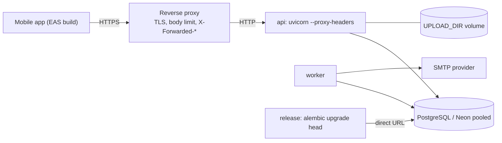

# Deployment

> Deploying to **Vercel** (serverless) with Neon instead? See [VERCEL.md](VERCEL.md). This
> page covers the Docker image (self-hosted / any container platform).

The backend deploys as **one Docker image** that runs three ways:

1. A **release job** that runs `alembic upgrade head`.
2. The **API** (uvicorn).
3. The **worker** (`python -m app.workers.worker`).

PostgreSQL ([Neon](NEON.md) or any PostgreSQL 15+) is the only stateful dependency. There is no
Redis. You need an SMTP provider, persistent storage for `UPLOAD_DIR`, and an HTTPS reverse
proxy in front of the API.



## 1. Build the production image

`backend/Dockerfile` has three stages: `base` (runtime dependencies), `dev` (adds test and lint
tools, used by compose), and **`prod`**. The `prod` stage contains only `alembic.ini`,
`alembic/` and `app/`, and runs as the non-root `app` user (uid 999).

```bash
docker build --target prod -t family-budget-api:0.2.0 backend
# tag with the git SHA as well, then push to your registry
docker tag family-budget-api:0.2.0 <registry>/family-budget-api:0.2.0
docker push <registry>/family-budget-api:0.2.0
```

The default command is
`uvicorn app.main:app --host 0.0.0.0 --port 8000 --proxy-headers --workers 2`. CI builds this
target on every push (`docker` job in `.github/workflows/ci.yml`).

## 2. Configure the environment

Put the variables in your platform's secret/env store, or in an env file readable only by the
deploy user (e.g. `/etc/family-budget/api.env`, mode 600). Full reference:
[ENVIRONMENT.md](ENVIRONMENT.md).

Required or strongly recommended:

```dotenv
ENVIRONMENT=production
DATABASE_URL=postgresql://fb_app:<pw>@ep-xxxx-pooler.<region>.aws.neon.tech/family_budget?sslmode=verify-full
DB_PGBOUNCER=true
DATABASE_MIGRATION_URL=postgresql://fb_owner:<pw>@ep-xxxx.<region>.aws.neon.tech/family_budget?sslmode=verify-full
JWT_SECRET_KEY=<48+ random bytes, unique to this environment>
ENABLE_DOCS=false
CORS_ORIGINS=
UPLOAD_DIR=/data/uploads
SMTP_HOST=<provider>
SMTP_PORT=587
SMTP_STARTTLS=true
SMTP_USERNAME=<user>
SMTP_PASSWORD=<secret>
EMAIL_FROM=Family Budget <no-reply@your-domain>
FORWARDED_ALLOW_IPS=<proxy address as seen by the api container>
```

Notes:

- `UPLOAD_DIR=/data/uploads` is needed in the `prod` image. That directory exists and is owned by
  `app`. The default `./data/uploads` resolves under `/app`, which the `app` user can't write to.
  Mount a persistent volume at `/data/uploads`.
- `ENVIRONMENT=production` turns on HSTS and JSON logs, disables `/docs`, and makes start-up fail
  if `JWT_SECRET_KEY` is a placeholder or `CORS_ORIGINS` contains `*`.
- `RATE_LIMIT_ENABLED` must stay `true` (the default).

## 3. Release step: migrations

Run migrations **once per deploy, before** starting the new API and worker containers. The
`prod` image deliberately doesn't migrate on boot, so replicas can't race each other.

```bash
docker run --rm --env-file /etc/family-budget/api.env \
  <registry>/family-budget-api:0.2.0 alembic upgrade head
```

- Alembic uses `DATABASE_MIGRATION_URL` (direct, owner role). See [NEON.md](NEON.md).
- If it fails, **stop the deploy**. The old version keeps running on the unchanged schema
  (PostgreSQL DDL is transactional).
- Write expand/contract migrations so the old version still works during the rollout. Strategy
  and rollback rules are in [MIGRATIONS.md](MIGRATIONS.md#upgrade-downgrade-and-rollback-strategy).

## 4. Run the API and the worker

Same image, same env file, different commands.

```bash
# API: published on localhost only; the reverse proxy is the public entry point
docker run -d --name fb-api --restart unless-stopped \
  --env-file /etc/family-budget/api.env \
  -v fb-uploads:/data/uploads \
  -p 127.0.0.1:8000:8000 \
  <registry>/family-budget-api:0.2.0

# Worker: sends email, runs housekeeping every 30 min
docker run -d --name fb-worker --restart unless-stopped \
  --env-file /etc/family-budget/api.env \
  <registry>/family-budget-api:0.2.0 python -m app.workers.worker
```

- **Run at least one worker.** Without it no verification or reset emails are sent, and expired
  sessions, tokens and counters are never purged. Several workers are safe because jobs are
  claimed with `FOR UPDATE SKIP LOCKED`. The worker handles SIGTERM cleanly.
- The worker doesn't touch `UPLOAD_DIR` today, so no volume is needed for it.
- **Scaling the API:** `--workers 2` gives two processes per container. Each holds a DB pool
  (`DB_POOL_SIZE` + `DB_MAX_OVERFLOW`). Avatars live on local disk, so run multiple API **hosts**
  only with shared storage at `/data/uploads`. S3-compatible storage is planned.
- **Health checks:**
  - `GET /health` is liveness (no DB). Use it for restart decisions and frequent uptime pings.
  - `GET /health/ready` runs `SELECT 1` and returns 503 when the DB is unreachable. Use it for
    load-balancer readiness.

  The image has no curl. Use
  `python -c "import urllib.request; urllib.request.urlopen('http://localhost:8000/health')"`,
  as `docker-compose.yml` does.
- **Logs:** JSON lines on stdout, with secrets redacted and a `request_id` on each line. Ship
  them to your log platform. The `X-Request-ID` response header ties a client report to a log
  line.

## 5. Reverse proxy (HTTPS)

**The API must only be reachable over HTTPS through a reverse proxy.** The app does not
terminate TLS. The proxy must:

1. **Terminate TLS** with a valid certificate (Let's Encrypt via Caddy or certbot, or your cloud
   load balancer) and redirect HTTP to HTTPS. The app adds
   `Strict-Transport-Security: max-age=63072000; includeSubDomains` itself when `ENVIRONMENT`
   is staging/production. Don't add a second, conflicting HSTS header at the proxy.
2. **Limit the request body size** (10 MB matches the app's own `Content-Length` cap). The app
   can't cap chunked bodies that have no `Content-Length`.
3. **Set `X-Forwarded-For` and `X-Forwarded-Proto`.** uvicorn runs with `--proxy-headers` and
   trusts those headers only from `FORWARDED_ALLOW_IPS` (default `127.0.0.1`). Set it to the
   proxy's address **as seen from inside the API container**. With Docker port publishing that
   is usually the bridge gateway (e.g. `172.17.0.1`), not `127.0.0.1`. If it is wrong, every
   client appears to have the proxy's IP. Per-IP rate limits then hit everyone at once, and
   sessions and audit logs record the wrong IP. Avoid `FORWARDED_ALLOW_IPS=*` unless the API
   port can't be reached except through the proxy.
4. Optionally add timeouts and basic connection or rate limits as a first line of defence.

Caddy example (`Caddyfile`):

```caddy
api.example.com {
    request_body {
        max_size 10MB
    }
    reverse_proxy 127.0.0.1:8000
}
```

Caddy obtains certificates automatically and sets `X-Forwarded-For`/`-Proto`.

nginx equivalent (inside the `server { listen 443 ssl; ... }` block):

```nginx
client_max_body_size 10m;
location / {
    proxy_pass http://127.0.0.1:8000;
    proxy_set_header Host $host;
    proxy_set_header X-Forwarded-For $proxy_add_x_forwarded_for;
    proxy_set_header X-Forwarded-Proto $scheme;
}
```

Check the proxy setup by signing in once, then looking at `GET /api/v1/users/me/sessions`. The
`ip_address` should be your real public IP, not the proxy's.

## 6. Mobile builds (EAS)

The app is a standard Expo SDK 58 project (`mobile/`). Bundle IDs are in `app.json`
(`org.familybudget.app`). **There is no `eas.json` in the repo yet.** Create it once with
`build:configure`.

```bash
cd mobile
npx eas-cli@latest login
npx eas-cli@latest build:configure          # creates eas.json and links the EAS project
npx eas-cli@latest build --platform android --profile production
npx eas-cli@latest build --platform ios --profile production
npx eas-cli@latest submit --platform android   # optional: upload to the store
```

- **Set `EXPO_PUBLIC_API_URL` per build profile** to your HTTPS API origin (no `/api/v1`), for
  example in `eas.json`:

  ```json
  { "build": { "production": { "env": { "EXPO_PUBLIC_API_URL": "https://api.example.com" } } } }
  ```

  You can also use EAS environment variables configured on expo.dev. The value is inlined at
  build time, so changing it needs a new build (or an update). It is public: never put secrets
  in `EXPO_PUBLIC_*`.
- Release builds must talk to **HTTPS**. Android blocks cleartext HTTP by default and iOS ATS does
  the same. A `preview` profile pointing at staging is useful for testers.
- Before building, run the mobile checks in [TESTING.md](TESTING.md#mobile)
  (`npm test`, `npm run typecheck`, `npm run lint`).

## 7. Production checklist

- [ ] Image built from a tagged commit with green CI (ruff, mypy, migrations, 45 backend + 18
      mobile tests, pip-audit, npm audit).
- [ ] `ENVIRONMENT=production`. `JWT_SECRET_KEY` is random, at least 48 bytes, unique, and stored
      in a secret store.
- [ ] `DATABASE_URL` uses the pooled host, `DB_PGBOUNCER=true`, the least-privilege `fb_app` role,
      and `sslmode=verify-full` (or at least `require`).
- [ ] `DATABASE_MIGRATION_URL` uses the direct host and the owner role. `alembic upgrade head` ran
      as a release step and `alembic current` shows the expected head.
- [ ] `ENABLE_DOCS=false` (forced in production, but also set it on public staging). `CORS_ORIGINS`
      is empty or an explicit list.
- [ ] HTTPS reverse proxy is in place with HTTP→HTTPS redirect and a 10 MB body limit. The API port
      isn't publicly reachable.
- [ ] `FORWARDED_ALLOW_IPS` is set correctly. The sessions list shows real client IPs.
- [ ] `UPLOAD_DIR=/data/uploads` is on a persistent, backed-up, encrypted volume.
- [ ] At least one worker is running. A test email (register flow) arrives from a domain with
      SPF/DKIM/DMARC.
- [ ] `/health` and `/health/ready` are wired to monitoring. JSON logs are shipped and retained.
- [ ] Backups: Neon history retention set, nightly off-platform `pg_dump`, uploads backed up, and
      a restore drill done ([BACKUP_RESTORE.md](BACKUP_RESTORE.md)).
- [ ] Mobile production build uses the HTTPS `EXPO_PUBLIC_API_URL`.
- [ ] A security contact is filled in ([SECURITY.md](SECURITY.md#reporting-a-vulnerability)).
