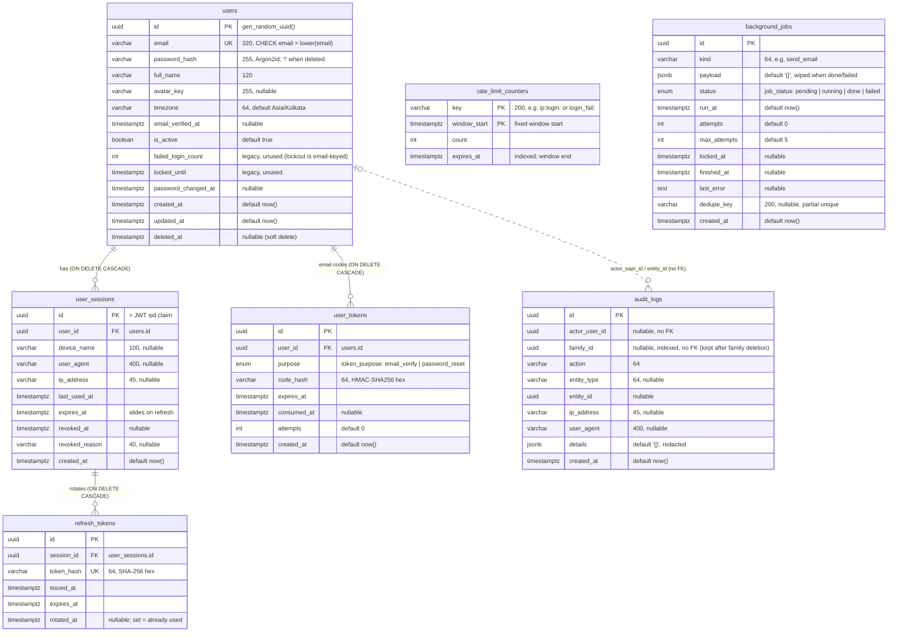

# Data model (ER)

All tables in the product spec (§13) are implemented. Alembic head is **`0003`**
(see [MIGRATIONS.md](MIGRATIONS.md)):

- **Section 1**: auth & platform tables, revision `0001`
  (`backend/app/models/user.py`, `backend/app/models/system.py`).
- **Section 2**: families, finance, planning, UPI and notification tables, revision `0002`
  (+ `0003`: `transactions.adjustment_sign`)
  (`backend/app/models/{family,finance,planning,upi,notification}.py`).

Conventions (`backend/app/db/base.py`, `backend/app/models/mixins.py`):

- Primary keys are `uuid`, with `gen_random_uuid()` server default (built into PG 13+, no
  extension needed).
- All timestamps are `timestamptz` (`DateTime(timezone=True)`) and stored in UTC.
- Money is always `NUMERIC(14,2)`, handled as Python `Decimal` and never as float; amounts are
  positive and the direction comes from the row's `type`. Money tables carry an ISO-4217
  `currency varchar(3)` (default `INR`).
- Python dicts map to `jsonb`.
- Constraint and index names are deterministic: `pk_<table>`,
  `fk_<table>_<col>_<referred>`, `uq_<table>_<col>`, `ck_<table>_<name>`, `ix_<col label>`.
- Soft delete uses a `deleted_at` column (users, families, accounts, categories, payees,
  transactions, attachments, budgets, recurring rules, savings goals and contributions);
  queries exclude deleted rows.
- Enums are PostgreSQL enum types: `job_status`, `token_purpose`, `family_role`,
  `invitation_status`, `record_scope`, `account_type`, `category_kind`, `transaction_type`,
  `transaction_status`, `transaction_source`, `payment_method`, `verification_status`,
  `budget_period`, `recurrence_frequency`, `goal_status`, `contribution_kind`,
  `upi_attempt_status`, `notification_category`, `push_status`, `device_platform`.
- **Scoped rows** (`ScopedOwnershipMixin`: accounts, payees, transactions, budgets, recurring
  rules, savings goals, UPI attempts) carry `owner_user_id` (creator, NOT NULL), `scope`
  (`personal` | `family`) and `family_id`, with `CHECK ck_<table>_scope_family`
  (`scope='family'` ⇔ `family_id IS NOT NULL`). Visibility is enforced in every query by
  `app.core.permissions.ScopeFilter` (personal → owner only; family → active members of a live
  family). Categories use a variant: built-in (no owner, no family), personal
  (`owner_user_id`) or family (`family_id`).

## 1. Auth & platform tables (revision 0001)

`alembic_version` (Alembic's own bookkeeping table) also exists.

### Indexes and constraints

| Table | Name | Definition |
|---|---|---|
| users | `pk_users` | PK (id) |
| users | `uq_users_email` | UNIQUE INDEX (email) |
| users | `ck_users_email_lowercase` | CHECK (email = lower(email)) |
| user_sessions | `fk_user_sessions_user_id_users` | FK user_id → users.id ON DELETE CASCADE |
| user_sessions | `ix_user_sessions_user_active` | (user_id, revoked_at) |
| refresh_tokens | `fk_refresh_tokens_session_id_user_sessions` | FK session_id → user_sessions.id ON DELETE CASCADE |
| refresh_tokens | `uq_refresh_tokens_token_hash` | UNIQUE (token_hash) |
| refresh_tokens | `ix_refresh_tokens_session_id` | (session_id) |
| user_tokens | `fk_user_tokens_user_id_users` | FK user_id → users.id ON DELETE CASCADE |
| user_tokens | `ix_user_tokens_user_purpose` | (user_id, purpose) |
| audit_logs | `ix_audit_logs_actor_created` | (actor_user_id, created_at) |
| audit_logs | `ix_audit_logs_entity` | (entity_type, entity_id) |
| audit_logs | `ix_audit_logs_family_id` | (family_id) |
| rate_limit_counters | `pk_rate_limit_counters` | PK (key, window_start) |
| rate_limit_counters | `ix_rate_limit_counters_expires_at` | (expires_at) |
| background_jobs | `ix_background_jobs_runnable` | (run_at) WHERE status = 'pending' |
| background_jobs | `uq_background_jobs_dedupe_key` | UNIQUE (dedupe_key) WHERE dedupe_key IS NOT NULL |

### Lifecycle notes

- **Account deletion** never deletes the `users` row. It sets `deleted_at` and `is_active=false`,
  rewrites `email` to `deleted-<id>@deleted.invalid` and `full_name` to "Deleted user", sets an
  unusable password hash, removes the avatar, and revokes all sessions. Shared family history
  (transactions, contributions, ...) keeps valid foreign keys.
- **Housekeeping** (worker, every 30 min) deletes sessions expired or revoked more than 30 days
  ago (their refresh tokens cascade), expired `refresh_tokens`, expired or consumed
  `user_tokens`, expired `rate_limit_counters`, and `done`/`failed` jobs finished more than 7
  days ago. `audit_logs` are never purged automatically.

## 2. Families, finance, planning, UPI, notifications (revisions 0002–0003)

Scoped rows (accounts, payees, transactions, budgets, recurring rules, savings goals, UPI
attempts) also have `owner_user_id`, `scope`, `family_id` and `created_at` / `updated_at` /
`deleted_at` (UPI attempts: no `deleted_at`); they are omitted from the boxes below.

```mermaid
erDiagram
    users ||--o{ family_members : "member of"
    families ||--o{ family_members : has
    families ||--o{ family_invitations : issues
    users ||--o{ family_invitations : "invited_by / accepted_user"

    users ||--o{ accounts : "owns (scoped)"
    families |o--o{ accounts : "family scope"
    users |o--o{ transaction_categories : "personal"
    families |o--o{ transaction_categories : "family"
    transaction_categories |o--o{ transaction_categories : "parent (1 level)"
    users ||--o{ payees : "owns (scoped)"
    transaction_categories |o--o{ payees : "default_category"

    users ||--o{ transactions : "created (owner_user_id)"
    families |o--o{ transactions : "family scope"
    accounts |o--o{ transactions : "account_id / to_account_id"
    transaction_categories |o--o{ transactions : classifies
    payees |o--o{ transactions : "paid to"
    transactions ||--o{ transaction_tags : "tagged (CASCADE)"
    transactions ||--o{ transaction_attachments : "receipts (CASCADE)"

    users ||--o{ budgets : "owns (scoped)"
    budgets ||--o{ budget_categories : "limits (CASCADE)"
    transaction_categories ||--o{ budget_categories : "limited"

    users ||--o{ recurring_transactions : "owns (scoped)"
    recurring_transactions |o--o{ transactions : "generates (recurring_id, period_key)"

    users ||--o{ savings_goals : "owns (scoped)"
    savings_goals ||--o{ savings_contributions : "receives (CASCADE)"
    transactions |o--o{ savings_contributions : "backed by"

    users ||--o{ upi_payment_attempts : "initiates (scoped)"
    payees |o--o{ upi_payment_attempts : "paid via UPI"
    upi_payment_attempts |o--o| transactions : "transaction_id / upi_attempt_id"

    users ||--o{ notifications : "receives (CASCADE)"
    families |o--o{ notifications : "about (CASCADE)"
    users ||--o{ notification_preferences : "per category (CASCADE)"
    users ||--o{ device_tokens : "registers (CASCADE)"
    user_sessions |o--o{ device_tokens : "bound to (SET NULL)"

    families {
        uuid id PK
        varchar name "80"
        varchar avatar_key "nullable"
        varchar currency "3, default INR"
        uuid created_by_user_id FK
        timestamptz deleted_at "nullable"
    }
    family_members {
        uuid id PK
        uuid family_id FK "CASCADE"
        uuid user_id FK
        enum role "family_role: owner | admin | member | viewer"
        timestamptz joined_at
        timestamptz left_at "nullable = active"
        uuid removed_by_user_id FK "nullable"
    }
    family_invitations {
        uuid id PK
        uuid family_id FK "CASCADE"
        varchar email "lowercase"
        enum role "never owner"
        uuid invited_by_user_id FK
        varchar token_hash UK "SHA-256 of the link token"
        enum status "pending | accepted | rejected | revoked | expired"
        timestamptz expires_at
        timestamptz responded_at "nullable"
        uuid accepted_user_id FK "nullable"
    }
    accounts {
        uuid id PK
        varchar name "80"
        enum type "bank | cash | upi | credit_card | debit_card | wallet | other"
        varchar institution "nullable"
        numeric opening_balance "NUMERIC(14,2), may be negative"
        varchar currency "3"
        boolean is_active "false = archived"
    }
    transaction_categories {
        uuid id PK
        uuid owner_user_id FK "personal; owner and family null = built-in"
        uuid family_id FK "family"
        uuid created_by_user_id FK "nullable"
        uuid parent_id FK "nullable (subcategory)"
        varchar name "60"
        enum kind "expense | income"
        varchar icon "Lucide name"
        varchar color "#RRGGBB(AA)"
        smallint sort_order
        boolean is_archived
        timestamptz deleted_at "nullable"
    }
    payees {
        uuid id PK
        varchar name "120"
        varchar upi_id "lowercase VPA, nullable"
        varchar mobile "nullable"
        varchar merchant_code "nullable"
        uuid default_category_id FK "nullable"
        timestamptz last_used_at "nullable"
        int use_count
    }
    transactions {
        uuid id PK
        enum type "expense | income | transfer | refund | adjustment"
        enum status "completed | pending | failed | cancelled"
        enum source "manual | upi_intent | import | recurring"
        numeric amount "NUMERIC(14,2) > 0"
        varchar currency "3"
        uuid account_id FK "nullable"
        uuid to_account_id FK "transfers only, != account_id"
        uuid category_id FK "nullable"
        uuid payee_id FK "nullable"
        varchar merchant "nullable"
        varchar description "nullable"
        text notes "nullable"
        enum payment_method "nullable"
        timestamptz occurred_at
        uuid recurring_id FK "nullable, set with period_key"
        varchar period_key "ISO due date, e.g. 2026-11-20"
        uuid upi_attempt_id FK "nullable, unique"
        varchar external_ref "UTR, nullable"
        varchar idempotency_key "unique per owner"
        enum verification "unverified | user_confirmed | verified"
        smallint adjustment_sign "+1 or -1, adjustments only (0003)"
    }
    transaction_tags {
        uuid transaction_id PK "FK CASCADE"
        varchar name PK "lowercase, 40"
    }
    transaction_attachments {
        uuid id PK
        uuid transaction_id FK "CASCADE"
        varchar storage_key UK "server-generated"
        varchar content_type "image/jpeg | application/pdf"
        int size_bytes "> 0"
        uuid uploaded_by_user_id FK
        timestamptz deleted_at "nullable"
    }
    budgets {
        uuid id PK
        uuid member_user_id FK "family scope only, nullable"
        varchar name "80"
        enum period "monthly | weekly | custom"
        date start_date
        date end_date "required for custom"
        numeric amount "NUMERIC(14,2) > 0"
        varchar currency "3"
        boolean carry_forward
        smallint_array alert_thresholds "default 50,75,90,100"
        boolean is_active
    }
    budget_categories {
        uuid id PK
        uuid budget_id FK "CASCADE"
        uuid category_id FK
        numeric amount "NUMERIC(14,2) > 0"
    }
    recurring_transactions {
        uuid id PK
        varchar name "80"
        enum type "expense | income | transfer"
        numeric amount "NUMERIC(14,2) > 0"
        varchar currency "3"
        uuid account_id FK "nullable"
        uuid to_account_id FK "transfers only"
        uuid category_id FK "nullable"
        uuid payee_id FK "nullable"
        enum frequency "daily | weekly | monthly | yearly"
        smallint interval_count ">= 1"
        date start_date
        date end_date "nullable"
        date next_due_date "generation cursor"
        smallint reminder_days_before
        boolean auto_generate
        boolean is_paused
        timestamptz last_generated_at "nullable"
    }
    savings_goals {
        uuid id PK
        varchar name "80"
        numeric target_amount "NUMERIC(14,2) > 0"
        date target_date "nullable"
        varchar currency "3"
        enum status "active | completed | archived"
        varchar icon "nullable"
        varchar color "nullable"
        timestamptz completed_at "nullable"
    }
    savings_contributions {
        uuid id PK
        uuid goal_id FK "CASCADE"
        uuid user_id FK "who added it"
        enum kind "deposit | withdrawal"
        numeric amount "NUMERIC(14,2) > 0"
        text note "nullable"
        timestamptz contributed_at
        uuid transaction_id FK "nullable, same scope and currency as the goal"
        timestamptz deleted_at "nullable"
    }
    upi_payment_attempts {
        uuid id PK
        uuid transaction_id FK "nullable, unique"
        uuid payee_id FK "nullable"
        varchar payee_vpa "lowercase"
        varchar payee_name "nullable"
        numeric amount "NUMERIC(14,2) > 0"
        varchar currency "INR"
        varchar note "nullable, 80"
        varchar tr_ref UK "our reference (tr), max 35"
        varchar idempotency_key "unique per owner"
        enum status "initiated | launched | success_reported | failure_reported | pending_reported | cancelled | expired"
        enum verification "unverified | user_confirmed | verified"
        varchar utr "nullable, user-reported"
        jsonb raw_return "UNTRUSTED, sanitised"
        timestamptz initiated_at
        timestamptz launched_at "nullable"
        timestamptz confirmed_at "nullable"
    }
    notifications {
        uuid id PK
        uuid user_id FK "CASCADE"
        uuid family_id FK "nullable, CASCADE"
        enum category "notification_category"
        varchar title "200"
        text body
        jsonb data
        varchar dedupe_key "unique per user"
        timestamptz read_at "nullable"
        timestamptz scheduled_for
        timestamptz sent_at "nullable"
        enum push_status "pending | sent | failed | skipped"
    }
    notification_preferences {
        uuid user_id PK "FK CASCADE"
        enum category PK
        boolean push_enabled
        boolean in_app_enabled
    }
    device_tokens {
        uuid id PK
        uuid user_id FK "CASCADE"
        uuid session_id FK "nullable, SET NULL"
        varchar token UK "Expo push token"
        enum platform "ios | android"
        timestamptz last_seen_at
        timestamptz disabled_at "nullable"
    }
```

### Key constraints (beyond PK/FK)

| Table | Constraint | Purpose |
|---|---|---|
| family_members | `uq_family_members_active_user` (family_id, user_id) WHERE left_at IS NULL | one active membership per user and family |
| family_members | `uq_family_members_active_owner` (family_id) WHERE owner and active | exactly one owner |
| family_invitations | `uq_family_invitations_pending_email` (family_id, email) WHERE pending · `ck_family_invitations_role_not_owner` | one pending invite per email; never invite an owner |
| transaction_categories | `uq_transaction_categories_owner_name` (owner, family, parent, kind, lower(name)) WHERE live, NULLS NOT DISTINCT | case-insensitive unique sibling names |
| payees | `uq_payees_owner_upi_id` (owner, family, upi_id) WHERE live, NULLS NOT DISTINCT | one payee per VPA per scope |
| transactions | `ck_transactions_amount_positive`, `…_transfer_accounts`, `…_recurring_period`, `…_adjustment_sign` | shape rules by type |
| transactions | `uq_transactions_recurring_id_period_key` | a recurring period is generated at most once (also after soft delete) |
| transactions | `uq_transactions_owner_user_id_idempotency_key` · `uq_transactions_upi_attempt_id` | client retries; one transaction per UPI attempt |
| budget_categories | `uq_budget_categories_budget_id_category_id` | one limit per category per budget |
| budgets | `ck_budgets_member_family_only`, `…_custom_has_end`, `…_date_order` | |
| upi_payment_attempts | `uq_upi_payment_attempts_owner_user_id_idempotency_key`, `…_tr_ref`, `…_transaction_id` | duplicate prevention |
| notifications | `uq_notifications_user_id_dedupe_key` | each alert/reminder fires once per user |
| device_tokens | `uq_device_tokens_token` | a token belongs to one user/session at a time |
| every scoped table | `ck_<table>_scope_family` | `scope='family'` ⇔ `family_id` set |

Built-in categories are seed rows of `transaction_categories` inserted by migration `0002`
(fixed UUIDs, owner and family NULL).

### Design notes

- **Tenant isolation** is enforced in queries, not by foreign keys: every read of a scoped row
  goes through `ScopeFilter` (membership is a correlated `IN (subquery)` on `family_members`),
  and every write through `require_family_access` / `require_record_write`
  (see [ARCHITECTURE.md](ARCHITECTURE.md) and [SECURITY.md](SECURITY.md)).
- **Balances are computed**, never stored: opening balance ± completed, non-deleted rows
  (`app/services/ledger.py`). A transfer is one row (`account_id` → `to_account_id`) and never
  counts as income/expense; refunds reduce expense; adjustments move a balance by
  `adjustment_sign` without being income/expense.
- **Recurring generation** inserts `(recurring_id, period_key)` with `ON CONFLICT DO NOTHING`,
  so concurrent workers can never duplicate a period.
- **UPI** stores only what the user and the UPI app reported. `raw_return` is untrusted;
  `verification` never becomes `verified` from the app flow. No PINs, bank passwords or card
  data are stored anywhere (see [SECURITY.md](SECURITY.md#what-is-never-stored)).
- **Budget category limits** on a soft-deleted category are ignored; deleting a category moves
  them (with `reassign_to`, merging amounts) or removes them, in the same DB transaction.
- **Alerts and reminders** dedupe on `notifications (user_id, dedupe_key)` (e.g.
  `budget:<id>:<period>:75`, `upi:<attempt>:pending:1`, `recurring:<id>:<period_key>:overdue`).
